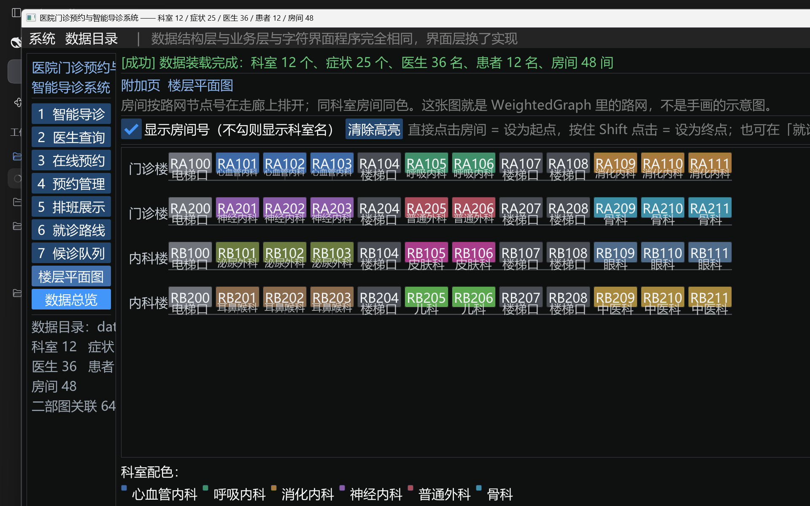
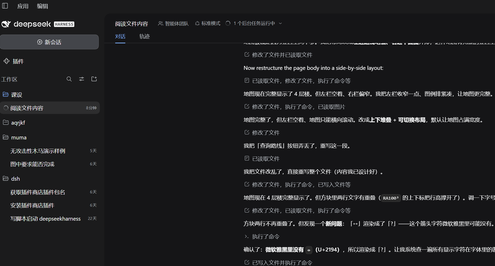

# 医院门诊预约与智能导诊系统

《数据结构》课程设计 第 1 题 · C++ 实现

---

## 一、题目要求与完成情况

| 题目要求 | 完成情况 |
| --- | --- |
| 科室、医生、排班、患者信息由文本文件读入 | ✅ 6 个数据文件，见 [04-数据文件格式.md](docs/04-数据文件格式.md) |
| 科室 ≥ 10 个 | ✅ 12 个 |
| 医生 ≥ 30 人 | ✅ 36 人（每科 3 人） |
| 智能导诊：按症状推荐科室 | ✅ 功能 1 |
| 医生查询：按科室、职称、擅长领域 | ✅ 功能 2 |
| 在线预约：检查号源并给出预约凭证 | ✅ 功能 3 |
| 预约管理：查看、取消 | ✅ 功能 4 |
| 排班展示 | ✅ 功能 5（表格形式） |
| 路线查询：不同科室不同医生的就诊路线 | ✅ 功能 6 |
| 候诊队列：签到、叫号、过号、就诊完成 | ✅ 功能 7 |
| 不使用现成的数据结构库 | ✅ 见 `src/ds.h`，全部自行实现 |

> **关于候诊队列**：题目把它列为扩展要求，但队列是课程的重点内容，
> 因此本项目把它当作**基本功能**完整实现（用环形队列，见 `src/ds.h`）。

**其余扩展功能**（症状权重的人工评定界面、停诊通知、患者评价、转诊推荐）
本阶段不写代码，只在 [01-需求分析.md](docs/01-需求分析.md) 与
[02-数据结构与算法.md](docs/02-数据结构与算法.md) 中给出设计思路，
说明各自动用哪种数据结构与算法。

## 二、课程约束的落地方式

课程要求「不能使用类库、模板等」。老师的说明是：**这条限制针对的是数据结构库**
（因为考查的就是数据结构与算法的运用），字符串、数学这类库不受限制。

因此本项目的做法是：

* **自行实现**：顺序表、环形队列、散列表、二维数组排班表、带权图（邻接矩阵 + Floyd）、
  带权二部图——六种都在 `src/ds.h`；
* **直接使用**：`<cstring>` 的 `strlen` / `strcmp` / `strstr`，`<cstdio>` 的
  `printf` / `fopen` / `fgets`，`<cstdlib>` 的 `atoi`；
* **不使用**：`std::string`、`vector`、map、`<algorithm>` 等容器与算法库——
  不是不允许，而是为了把数据结构的实现摆出来，方便答辩时讲。

唯一的例外是 C++ 的**模板语法**：`SeqList<T, N>`、`RingQueue<T, N>`、
`ScheduleTable<日期, 时段>` 用模板参数给出元素类型与容量，这样同一个结构只写一份，
不必为每种元素类型复制一遍。模板是语言特性而不是类库。

> **图形界面用的是第三方库（Dear ImGui）**，这不是破例：课程要求原文是
> 「不能使用类库、模板等（**用户界面除外**）」，界面部分本来就允许用现成的库。
> 而且它只被界面层用到，`ds.h`、`ds_sort.h` 里那六种数据结构和
> `service.h`、`service_queue.h` 里的算法全部是自己写的，一行都没交给它。
> 选型理由与用了哪些文件见 [third_party/README.md](third_party/README.md)。

## 二·补、两套界面，同一份数据与算法

题目要求「以图形化方式展示科室分布、医生排班和预约状态」，因此本工程有两个主程序：

| 程序 | 界面 | 适用场合 |
| --- | --- | --- |
| `build\hospital.exe` | 字符界面（`src\menu*.h` + `printf`） | 讲数据结构与算法、跑自动化用例 |
| `build\hospital_gui.exe` | 图形界面（`gui\src\panel*.cpp` + Dear ImGui + DirectX 11） | 演示科室分布平面图、号源日历、就诊路线 |

两者**共用同一份数据结构层、数据层与业务层**，只有界面层是两套实现：

```
        hospital.exe                    hospital_gui.exe
   src/menu.h  src/menu_queue.h     gui/src/panel_*.cpp
             └──────────┬──────────────────────┘
                        │  都只调用下面这些，界面层互不相干
   ┌────────────────────▼────────────────────┐
   │ 业务层  service.h（Triage / Route）        │
   │         service_queue.h（Queue）           │
   ├──────────────────────────────────────────┤
   │ 数据层  model.h（Hospital 总库）           │
   │         load.h（6 个文本文件装载）          │
   ├──────────────────────────────────────────┤
   │ 数据结构层  ds.h（六种自研结构）            │
   │             ds_sort.h（插入排序）           │
   └──────────────────────────────────────────┘
```

**能做到这件事，是因为业务层从一开始就只返回 struct、不 printf** ——
`Triage::run()` 返回 `TriageResult`、`Route::between()` 返回 `RouteResult`、
`Queue::*` 返回 `QueueResult` 枚举。界面层想怎么画就怎么画，业务层一行都不用改。
当初在字符界面下定的这条规矩，换成图形界面时直接省掉了一次重构。

图形界面的「楼层平面图」页（房间按路网节点号排开、同科室同色，点击可选起点终点）：



「排班展示」页：格内是「余号/总数」，颜色越绿越好约，点任意格子直接带到预约页：



「候诊队列」页：签到、叫号、过号、就诊完成四个动作，走的是同一个环形队列：


### 怎么验证

数据结构层与业务层用一组**可预期的输入**单独验证过（332 项断言，全部通过），
两个界面则按功能逐个走了一遍，边界与出错用例逐条对过。

**测试用例与实测输出全部收在 [05-测试记录.md](docs/05-测试记录.md)** ——
里面的日志都是从程序控制台原样复制的，可以直接作为课程设计报告【测试】一章的素材。

值得一提的是一次「跑起来才发现的」缺陷，它们**编译期一个警告都没有**（`/W4` 全绿）：

| 缺陷 | 现象 | 根因与修法 |
| --- | --- | --- |
| 按钮文字被裁 | 「生成预约凭证」显示成「生成预约凭」 | 按钮宽度按小字号写死（160px），而 150% DPI 下字体是 27px、需要 189px。改成用 `CalcTextSize` 量出文字宽度再加内边距 |
| 列里的按钮被裁 | 「就诊完成，离开队列」显示成「就诊完成，离」 | 表格用 `SizingFixedFit` 按内容算列宽，把按钮卡在列内。改成两列等分 |
| 长说明被裁 | 页面顶部的说明文字右边被切掉 | 用了 `TextDisabled`（不折行）。改成 `TextWrapped` |

这三处说明「能编译、能链接、不报警告」并不等于界面是对的 —— 必须真的跑起来看。

## 三、数据结构与题目实现提示的对应

题目的【实现提示】给了五条，本项目的做法逐条对应如下：

| 提示 | 本项目的实现 | 位置 |
| --- | --- | --- |
| 1. 症状与科室的关联用**加权二部图**，两者为顶点、关联强度为边权 | `BipartiteGraph`：症状侧顶点 25 个、科室侧顶点 12 个、32 条边；两侧邻接链用前向星组织，症状→科室与科室→症状都能 O(度) 遍历 | `ds.h` |
| 2. 智能导诊基于该图，**把患者症状与科室描述匹配** | 患者从症状表里选出症状（选中的下标就是症状顶点号）→ 沿二部图对每个科室做邻域加权求和 → 按得分插入排序取前几名 | `service.h` |
| 3. 排班用**二维数组**，按日期和时段索引 | `ScheduleTable<日期, 时段>`，每位医生一张二维表放在医生记录里；两个下标就是主键，查询 O(1) | `ds.h` / `model.h` |
| 4. 预约时**检查并扣减剩余号源**，保证并发安全 | 停诊检查、余量检查、扣减连着做完不让出执行权，因此这一段是原子的；槽带版本号，号源一变旧信息立刻作废，不会超卖 | `menu.h` |
| 5. 候诊队列用**队列**实现，支持签到、叫号、过号 | `RingQueue<Waiting>`：签到入队、医生叫号、过号记次（满 2 次重新排队）、就诊完成出队；队首已叫号时不允许越过他叫后面的人 | `ds.h` / `service_queue.h` |

## 四、目录结构

```
课设/
├── src/
│   ├── ds.h            数据结构：顺序表 / 环形队列 / 散列表 / 二维数组 / 带权图 / 带权二部图
│   ├── ds_sort.h       插入排序（通用版本，与业务无关）
│   ├── model.h         数据模型：科室、医生、房间、患者、预约、候诊 + 数据总库 Hospital
│   ├── load.h          数据装载（按外键顺序读入 6 个文本文件）
│   ├── service.h       业务算法：导诊（二部图打分）Triage / 就诊路线 Route
│   ├── service_queue.h 业务算法：候诊队列 Queue（签到、叫号、过号、完成）
│   ├── ui.h            界面辅助：表格对齐、读输入
│   ├── menu.h          功能 1~6 的界面流程
│   ├── menu_queue.h    功能 7 候诊队列的界面流程
│   ├── main.cpp        程序入口与主菜单
│   └── db.cpp          数据总库的唯一实例（两个主程序共用）
├── Hospital.sln        Visual Studio 解决方案（三个项目）
├── Hospital.vcxproj    字符界面主程序的项目文件
├── HospitalGui.vcxproj 图形界面主程序的项目文件
├── GenData.vcxproj     测试数据生成器的项目文件
├── data/             测试数据（由 tools/gen_data 生成，程序只读）
│   ├── symptoms.txt     25 个症状顶点
│   ├── depts.txt        12 个科室及其描述、二部图的边（症状:权重）
│   ├── doctors.txt      36 名医生
│   ├── schedules.txt    一周排班
│   ├── patients.txt     12 名患者
│   └── layout.txt       4 个楼层共 48 个房间以及它们之间的路线
├── gui/             图形界面（界面层，只被 hospital_gui.exe 使用）
│   └── src/
│       ├── gui_main.cpp     入口、主框架、左侧导航、提示条
│       ├── gui_app.cpp      窗口 + DirectX 11 + ImGui 的初始化与主循环
│       ├── gui_font.cpp     中文字体装载（按需收集字形范围）
│       ├── gui_common.h/.cpp 下标→名字的翻译、号源状态与配色
│       ├── gui_state.h/.cpp GUI 自己的界面状态（选了谁、当前在哪一页）
│       ├── panels.h         九个页面的入口声明
│       ├── panel_triage.cpp   功能 1 智能导诊
│       ├── panel_doctor.cpp   功能 2 医生查询
│       ├── panel_booking.cpp  功能 3 在线预约
│       ├── panel_manage.cpp   功能 4 预约管理
│       ├── panel_schedule.cpp 功能 5 排班展示
│       ├── panel_route.cpp    功能 6 就诊路线
│       ├── panel_queue.cpp    功能 7 候诊队列
│       ├── panel_floor.cpp    附加：楼层平面图（图形化展示科室分布）
│       └── panel_about.cpp    附加：数据总览（各结构装了多少、占多少字节）
├── third_party/      第三方库（只有图形界面程序用到）
│   ├── README.md       为什么选 Dear ImGui、用了哪些文件
│   └── imgui/          Dear ImGui v1.92.9b（MIT 许可）
├── tools/
│   ├── gen_data.cpp     测试数据生成器
│   ├── build.bat        构建（自动定位 MSVC）
│   ├── run.bat          一键构建并运行字符界面
│   ├── run_gui.bat      一键构建并运行图形界面
│   └── fix-encoding.bat 给源码补 UTF-8 BOM（新增源文件后跑一次）
├── 数据结构原型说明.md   第一阶段交付：数据结构清单 + 每个类的逐个说明
└── docs/
    ├── 01-需求分析.md
    ├── 02-数据结构与算法.md
    ├── 03-程序结构设计.md
    ├── 04-数据文件格式.md
    └── 05-测试记录.md
```

## 五、构建与运行

需要 Visual Studio 2022 或更高版本（含「使用 C++ 的桌面开发」工作负载），Windows 系统。

### 方式一：Visual Studio（推荐平时开发用）

打开 **`Hospital.sln`**，解决方案里有三个项目：

| 项目 | 产出 | 说明 |
| --- | --- | --- |
| **Hospital** | `build\hospital.exe` | 字符界面主程序：医院门诊预约与智能导诊系统 |
| **HospitalGui** | `build\hospital_gui.exe` | 图形界面主程序（Dear ImGui + DirectX 11），七项功能 + 楼层平面图 |
| **GenData** | `build\gen_data.exe` | 测试数据生成器：生成 `data\` 下的 6 个数据文件 |

按顺序做三件事：

1. 右键 **GenData** → 设为启动项目 → `Ctrl+F5` 运行（**只需做一次**，生成测试数据）
2. 右键 **Hospital** → 设为启动项目 → `Ctrl+F5` 运行（字符界面）
3. 右键 **HospitalGui** → 设为启动项目 → `Ctrl+F5` 运行（图形界面）

三个项目的输出都放在工程根的 `build\` 目录，调试时的工作目录也设成工程根，
所以程序能按相对路径找到 `data\`，不需要手工拷贝数据文件。

> **为什么是三个项目而不是一个**：三个程序各自有一个 `main()`，
> C++ 里一个可执行程序只能有一个 `main`，放在同一个项目里会链接冲突。
> 其中 **Hospital 与 HospitalGui 共用同一份数据结构层（`src/ds.h`）、数据层
> （`src/model.h`、`src/load.h`）与业务层（`src/service.h`、`src/service_queue.h`）**，
> 区别只在界面层 —— 一个用 `src/menu*.h` + `printf`，一个用 `gui/src/panel*.cpp` + ImGui。
> 这正是当初「业务层只返回 struct、不 printf」这条分层约定换来的好处。
>
> 项目属性里已经把该配的都配好了：包含目录 `src`、语言标准 C++17、
> `/utf-8`（源码带 UTF-8 BOM，且窄字符串字面量必须按 UTF-8 输出）、
> 警告等级 4、关闭 `fopen` 的「不安全」警告。
> HospitalGui 另外加了 ImGui 的包含目录与 `d3d11.lib` / `d3dcompiler.lib` / `dxgi.lib`；
> 第三方源码用 /W3（自己写的代码仍是 /W4），否则 ImGui 的跨平台代码会刷屏。
> 这些与 `tools\build.bat` 里的开关保持一致，两条路径编译出的行为相同。

### 方式二：命令行（一条命令搞定，缺什么自动补什么）

```bat
tools\run.bat          rem 字符界面
tools\run_gui.bat      rem 图形界面
```

也可以分步执行：

```bat
cd 课设

rem 1. 生成测试数据（只需一次；改过 gen_data.cpp 后重跑）
tools\build.bat gen
build\gen_data.exe data

rem 2. 构建程序
tools\build.bat            rem -> build\hospital.exe      字符界面
tools\build.bat gui        rem -> build\hospital_gui.exe  图形界面（首次约 1~2 分钟，要编 ImGui）
tools\build.bat clean      rem 清掉整个 build\ 目录

rem 3. 运行
build\hospital.exe          rem 字符界面
build\hospital_gui.exe      rem 图形界面

rem 也可以指定数据目录，便于用另一套数据做测试
build\hospital.exe 数据目录名
build\hospital_gui.exe 数据目录名
```

> **图形界面要点**：
> * 它需要 **DirectX 11**（Windows 10/11 自带，不用装任何东西）。
>   如果机器没有可用的显卡驱动，程序会自动退回软件渲染（WARP），仍然能跑。
> * 中文靠**装载系统里的中文字体**显示（按 微软雅黑 → 黑体 → 宋体 → 等线 的顺序找）。
>   一个字都缺不了：程序会把数据文件里读到的全部中文加上界面固定文案，
>   一起登记成字形范围再建贴图。找不到中文字体时会在控制台明确报出来，不静默变方块。
> * 界面按 DPI 缩放自适应（125%/150% 缩放的笔记本上，窗口尺寸与字号都会跟着放）。
> * 命令行日志仍然打印（子系统是 Console），插上参数就能排查装载问题。

> **改过源码后，请先跑一次 `tools\fix-encoding.bat`。**
> MSVC 默认按系统代码页（简体中文是 936/GBK）读源文件。UTF-8 的中文注释被按 GBK
> 解析时，某个汉字的次字节可能是 `0x5C`，会被当成续行符吞掉下一行代码，报出一堆
> 莫名其妙的错误。加 BOM 之后 MSVC 与 g++/clang 都能正确识别为 UTF-8。
> 构建脚本已统一加 `/utf-8`，保证窄字符串字面量也按 UTF-8 生成，与数据文件编码一致。

## 六、测试

数据结构层与业务层用一组**可预期的输入**单独验证过：把每个结构拿出来，
用自然构造的小例子（数、字符、简单结构体）调用它，再和预期结果比一比 ——
七个结构共 **332 项断言，全部通过**。两个界面则按功能逐个走了一遍，
边界与出错用例也逐条对过。

**完整用例与实测输出见 [05-测试记录.md](docs/05-测试记录.md)**，
包括：

* 七个结构各自的断言数与覆盖内容；
* 四个功能用例（导诊打分、就诊路线、排班、候诊队列）的预期值与实测值对照；
* 18 条边界与出错用例（超范围输入、号源已满、重复签到、越队叫号、坏数据行……）；
* 图形界面的测试过程，以及它抓出来的三个界面缺陷。

为了让交付代码更紧凑，产生那些日志的两套自检程序已经移出工程；
测试记录里的日志是它们在工程内时的实际运行输出，可据此复现。


```
正在装载数据...
装载完成：科室 12 个 / 症状 25 个（二部图 64 条关联）/ 医生 36 名 / 患者 12 名 / 房间 48 间

================ 医院门诊预约与智能导诊系统 ================
  1. 智能导诊     描述症状，推荐科室
  2. 医生查询     按科室 / 职称 / 擅长领域查询
  3. 在线预约     选医生与时段，生成预约凭证
  4. 预约管理     查看与取消本人的预约
  5. 排班展示     查看医生一周排班与余号
  6. 就诊路线     查询两个诊室之间的走法
  7. 候诊队列     签到排队、叫号、过号、就诊完成
  0. 退出
============================================================
```

**功能 1 智能导诊**（患者选症状 4 胸闷、2 咳嗽、6 气短）：

```
---------- 推荐科室（按匹配得分排序）----------
序号   科室           得分   推荐依据                   位置
1      心血管内科     5      气短 胸闷                  门诊楼1层东侧
2      呼吸内科       5      气短 咳嗽                  门诊楼1层西侧
3      儿科           4      气短 咳嗽                  内科楼2层西侧
```

**功能 5 排班展示**：

```
D1 王秀英（主任医师）一周排班：
日期     上午             下午             备注
周1      余 15 / 共 15    不出诊
周2      不出诊           余 10 / 共 10
周3      余 15 / 共 15    不出诊
...
```

**功能 6 就诊路线**（RA101 → RB209）：

```
全程约 70 米，途经 5 个节点，换层 1 次

  ■ 门诊楼1层心血管内科诊室 累计   0 米
  ○ 门诊楼1层电梯口         累计  10 米
  ○ 内科楼2层电梯口         累计  30 米
  ○ 内科楼2层楼梯口         累计  60 米
  ■ 内科楼2层中医科诊室     累计  70 米

换层指引：
  在「门诊楼1层电梯口」乘电梯，到达 4 层的「内科楼2层电梯口」
```

**功能 7 候诊队列**（两位患者签到后叫号）：

```
D1 王秀英（主任医师）的候诊队列，共 2 人：
诊室：门诊楼1层心血管内科诊室

排队号     患者编号     姓名         状态
1          P1           张伟         等待中（前面 0 人）
2          P2           王芳         等待中（前面 1 人）

---------- 叫号 ----------
  请 P1 张伟（排队号 1）到 门诊楼1层心血管内科诊室 就诊。
```

## 七、代码规模

### 数据结构层 + 数据层 + 业务层（两个主程序共用）

| 文件 | 行数 | 说明 |
| --- | --- | --- |
| `src/ds.h` | 467 | 六种数据结构 |
| `src/model.h` | 213 | 数据模型与总库 |
| `src/load.h` | 429 | 数据装载与校验 |
| `src/service.h` | 156 | 智能导诊（二部图打分）与就诊路线两个算法 |
| `src/service_queue.h` | 165 | 候诊队列的算法 |
| `src/db.cpp` | 13 | 数据总库的唯一实例 |
| `src/ds_sort.h` | 75 | 通用插入排序（与业务无关） |
| | **1518** | **这一层两个主程序共用，是课程考核的核心** |

### 界面层之一：字符界面

| 文件 | 行数 | 说明 |
| --- | --- | --- |
| `src/ui.h` | 107 | 界面辅助（含带范围的整数解析） |
| `src/menu.h` | 499 | 功能 1~6 的界面流程 |
| `src/menu_queue.h` | 304 | 功能 7 候诊队列的界面流程 |
| `src/main.cpp` | 116 | 入口与主菜单 |
| | **1026** | |

### 界面层之二：图形界面

| 文件 | 行数 | 说明 |
| --- | --- | --- |
| `gui/src/gui_main.cpp` | 307 | 入口、主框架、左侧导航、提示条 |
| `gui/src/gui_app.cpp` + `.h` | 337 | 窗口 + DirectX 11 + ImGui 初始化与主循环 |
| `gui/src/gui_font.cpp` + `.h` | 179 | 中文字体装载（按需收集字形范围） |
| `gui/src/gui_common.h` | 100 | 下标→名字的翻译、号源状态与配色 |
| `gui/src/gui_state.h` + `.cpp` | 137 | GUI 自己的界面状态 |
| `gui/src/panels.h` + `panel_common.cpp` | 139 | 页面入口声明、号源格子与图例 |
| `gui/src/panel_*.cpp` × 10 | 2089 | 七项功能 + 楼层平面图 + 数据总览 |
| | **3288** | 只被 `hospital_gui.exe` 使用 |

### 辅助程序与第三方

| 文件 | 行数 | 说明 |
| --- | --- | --- |
| `tools/gen_data.cpp` | 277 | 测试数据生成器（不属于交付程序） |
| `third_party/imgui/` | 约 59000 | Dear ImGui v1.92.9b（**第三方，不算自己的代码量**） |

**自己写的代码合计 6109 行** = 共用层 1518 + 字符界面 1026 + 图形界面 3288 + 数据生成器 277。
其中课程考核重点 —— 数据结构层与业务层 —— 是**共用层那 1518 行**，
两个界面都只是它的调用者。

> 为控制交付规模，早先用来验证数据结构与图形界面的两套自检程序已移出工程。
> 它们的实际运行输出保存在 [05-测试记录.md](docs/05-测试记录.md) 里，可直接引用。

## 八、版本管理

项目用 Git 管理，提交历史按功能点组织，每个提交都是可编译、可运行的状态。
