# 使用说明书

> 医院门诊预约与智能导诊系统 —— 图形界面（Qt 6）使用指南
>
> 本文档面向**第一次使用本系统的人**，按"打开 → 登录 → 点哪里 → 看到什么"的顺序写成，
> 每一步都配实际运行截图。截图来自程序的 `--shots` 模式，是真实运行画面。

---

## 一、这个系统是什么

系统分成**两个独立程序**，分别给两类人用：

| 程序 | 给谁用 | 能做什么 |
|---|---|---|
| **患者端** `patient.exe` | 患者本人 | 智能导诊、查医生、在线预约、取消/评价自己的预约、查就诊路线、签到候诊 |
| **管理端** `admin.exe` | 医院工作人员 / 医生 | 登记患者与医生、排班管理（停诊/换班）、叫号、查看全部预约、数据自检 |

两个程序**共用同一份数据**。默认情况下它们各自独立运行；加 `--shared` 参数时，
两个程序会连到同一份共享数据上，**一方改了另一方立刻能看到**。

---

## 二、准备：构建与生成数据

### 2.1 第一次使用

```bat
tools\build.bat gen          :: 生成测试数据到 data\（只需一次）
tools\build_qt.bat           :: 构建患者端与管理端
```

构建完成后，`build\` 目录下会有：

```
build\patient.exe     患者端
build\admin.exe       管理端
build\hospital.exe    字符界面版本（备用，功能等价）
build\gen_data.exe    测试数据生成器
```

### 2.2 日常启动

| 想做什么 | 命令 |
|---|---|
| 打开患者端 | `tools\run_qt.bat patient` |
| 打开管理端 | `tools\run_qt.bat admin` |
| 两端同时用（共享数据） | 两个窗口分别执行 `tools\run_qt.bat patient --shared` 和 `tools\run_qt.bat admin --shared` |

> **提示**：`run_qt.bat` 会自动把工作目录切到工程根，并把 Qt 的运行库加进 PATH，
> 所以不用手动设置环境变量。

---

## 三、患者端使用说明

### 3.1 登录

患者端启动后**第一件事是登录**。系统里没有"注册"按钮 —— 因为在医院场景下，
**建档（注册）由医院完成**，患者本人不需要自己注册。

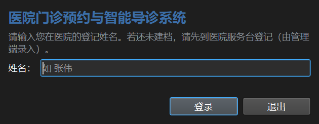

**操作**：

1. 在「姓名」框里输入你在医院登记的名字（例如 `张伟`）
2. 点「登录」，或直接按 `Enter`

**三种结果**：

| 情况 | 系统反应 |
|---|---|
| 姓名**唯一匹配** | 直接进入主界面 |
| 有**多人同名** | 弹出候选列表，显示「编号 + 姓名 + 电话后 4 位」，让你自己认领 |
| **查不到** | 提示"没有找到「张三」的建档记录，请先到医院服务台登记（管理端 →「人员管理」→ 新增患者）" |

> 如果提示查不到，请让医院工作人员在**管理端**的「人员管理」页把你登记进去，
> 登记完再回患者端登录即可，不需要重启程序。

**登录后**，界面左下角状态栏会一直显示你的身份，例如：

```
[P1 张伟] [单进程] 科室 12 · 症状 25（关联 64） · 医生 36 · 患者 12 · 房间 48
```

同时，所有涉及"患者是谁"的下拉框都会**锁定为你本人**（变灰、不能改），
这是权限边界 —— 患者不能查看或操作别人的预约。

---

### 3.2 功能 1：智能导诊

不知道自己该挂哪个科室时用这一页。

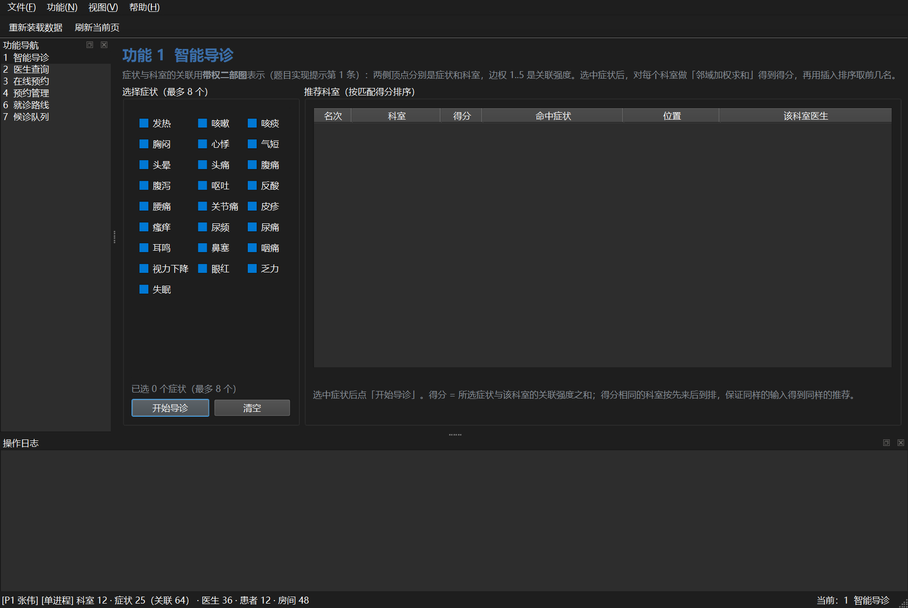

**操作步骤**：

1. **左侧「选择症状」**：勾选你有的症状（共 25 个，3 列排列）。最多选 8 个。
2. 点「**开始导诊**」。
3. **右侧表格**给出推荐科室，按匹配得分从高到低排列：

| 列 | 含义 |
|---|---|
| 名次 | 推荐排序 |
| 科室 | 推荐的科室名 |
| 得分 | 匹配得分（你选的症状与该科室的关联强度之和） |
| 命中症状 | 具体是哪几个症状匹配上了 |
| 位置 | 该科室在哪个楼哪一侧 |
| 该科室医生 | 该科室的医生，按「患者评分 + 职称」排序，括号里是评分 |

4. **点表格任意一行**，下方会显示该科室全部医生的完整信息（职称、擅长、评分）。

**要点**：

- 得分相同的科室按先来后到排，**同样的输入永远得到同样的推荐**（结果可复现）。
- 想重新选，点「**清空**」。
- 记下推荐科室后，去「3 在线预约」约号即可。

---

### 3.3 功能 2：医生查询

想按条件找医生时用这一页。

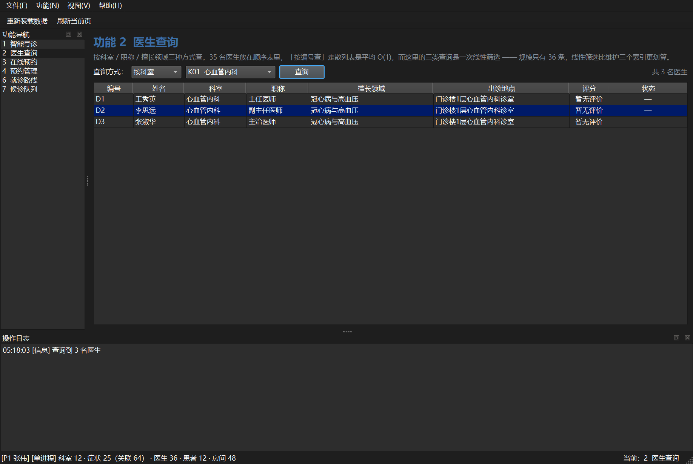

**操作步骤**：

1. 在「**查询方式**」下拉框里选一种：
   - **按科室** —— 选科室，列出该科室所有医生
   - **按职称** —— 选职称（主任医师 / 副主任医师 / 主治医师 / 住院医师）
   - **按擅长领域** —— 输入关键词，例如 `高血压`、`咳嗽`
2. 点「**查询**」（或在关键词框里按 `Enter`）。

结果表包含：编号、姓名、科室、职称、擅长领域、出诊地点、评分、状态。

> 评分显示为「4.8 分（12 人）」这种格式，表示 12 位患者平均打了 4.8 分。
> 还没人评价的医生显示「暂无评价」。

---

### 3.4 功能 3：在线预约

这是最核心的一页。

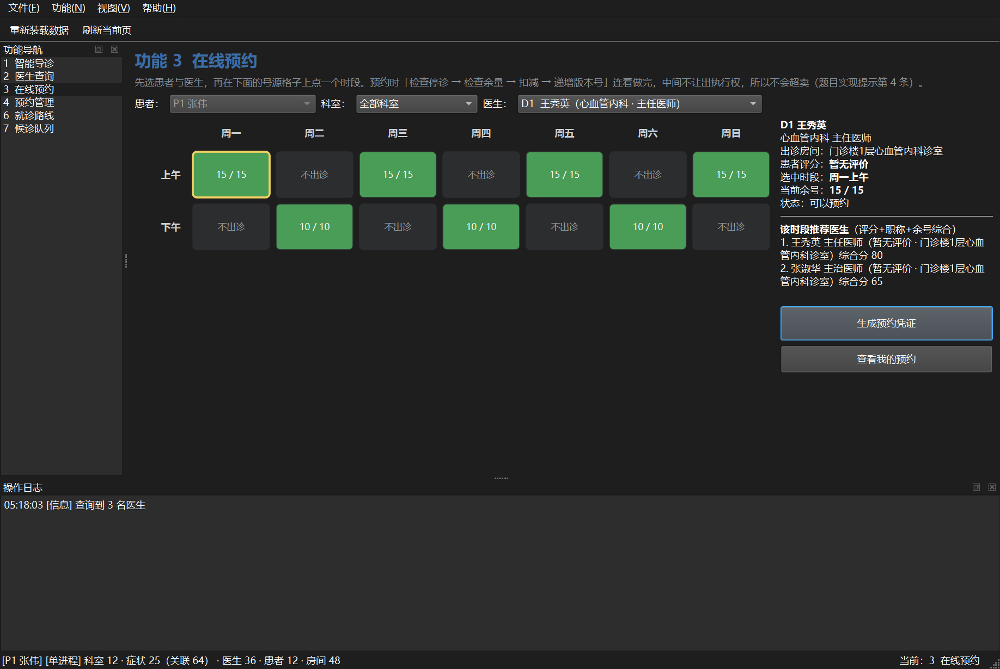

界面分成三块：**上方条件行**、**左侧号源格子**、**右侧信息面板**。

#### 第一步：确认患者与医生

- **患者**：已锁定为登录者（灰色不可改）
- **科室**：可以先按科室筛选医生（选「全部科室」则不筛选）
- **医生**：选你要挂的医生

#### 第二步：在号源格子上选时段

中间的格子里是**医生一周的出诊情况**：

```
        周一      周二      周三  ...
上午   15 / 15   不出诊    15 / 15
下午   不出诊    10 / 10   不出诊
```

- **格内数字**：`余号 / 总号源`
- **颜色**：
  - 🟩 **绿色** = 号源充足
  - 🟨 **黄色** = 号源紧张（余号 ≤ 3）
  - 🟥 **红色** = 号已约满
  - ⬛ **灰色** = 该时段不出诊 / 已停诊
- **点击格子**即选中（会被黄框标出），**右上方会立刻显示该时段的详细信息**

> 把鼠标停在格子上不动，会弹出小提示告诉你"该时段余 X 个、共 Y 个"。

#### 第三步：看右侧信息面板

选中格子后，右侧会显示：

- **医生信息**：编号姓名、科室职称、出诊房间
- **患者评分**：该医生的评价得分
- **选中时段**：例如「周一上午」
- **当前余号**：例如 `15 / 15`
- **状态**：可以预约 / 号源紧张 / 号已满 / 已停诊
- **该时段推荐医生**（如果该科室有多位医生同时出诊）：按「评分 50% + 职称 30% + 余号 20%」算出的综合分排序，方便你在同科室里挑一位

#### 第四步：生成凭证

点「**生成预约凭证**」，成功后弹出凭证窗口：

```
预约凭证 TK0001
患者     P1 张伟
科室     心血管内科
医生     D1 王秀英（主任医师）
时间     周一上午
地点     门诊楼1层心血管内科诊室
该时段剩余号源   14
```

记下**凭证号**（如 `TK0001`），到院和取消时都要用。

**可能遇到的提示**：

| 提示 | 原因 | 怎么办 |
|---|---|---|
| 该时段号源已满，预约失败 | 号被别人抢光了 | 换一个时段或换医生 |
| 该时段已停诊，预约失败 | 医生停诊 | 换时段，或选相近科室 |
| 你在该时段已有预约 TK0001，不能重复预约 | 同一时段已约过别的医生 | 先到「预约管理」取消原预约 |

> **关于"号源紧张时推荐相近科室"**：如果该科室这个时段号已经满了，
> 右侧会额外列出**症状相近且还有号**的其它科室（附相似度百分比与余号），
> 按提示改选科室即可。

---

### 3.5 功能 4：预约管理

查看、取消自己的预约，以及**评价医生**。

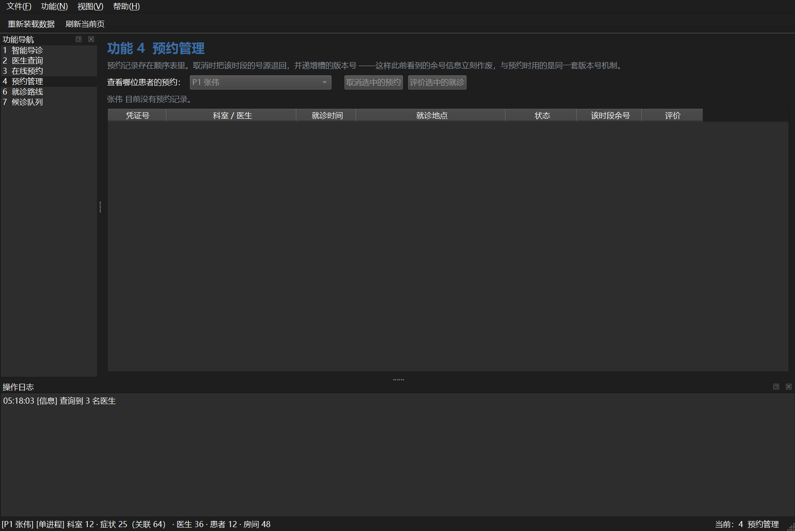

**操作步骤**：

1. 患者已锁定为登录者，表格直接列出你的全部预约记录。
2. 表格列：凭证号、科室/医生、就诊时间、就诊地点、状态、该时段余号、评价。
3. **状态说明**：

| 状态 | 含义 |
|---|---|
| 已预约 | 正常，等待就诊 |
| 已完成 | 已就诊结束（管理端点了「就诊完成」） |
| 已取消 | 你自己取消的 |
| 因停诊取消 | 医生停诊，且没找到替代时段 —— 需要你重新约 |
| 因停诊改约 | 医生停诊，系统已**自动帮你改到别的时段**（下方会多出一条新记录） |

#### 取消预约

1. 点表格里那一行选中它
2. 点「**取消选中的预约**」
3. 弹窗会列出这条预约的详情让你确认，点「是」

取消后号源会退回，别人可以重新约。

#### 评价医生

只有当这条预约状态是「**已完成**」且还没评过价时，按钮才可用。

1. 选中那条已完成的记录
2. 点「**评价选中的就诊**」
3. 在弹出的对话框里打分（1 = 很不满意，5 = 非常满意）
4. 确定

评价会累加到该医生的评分里，**并且会影响后续「该科室医生」的推荐排序**
（综合分里评分占 50%）。同一条预约只能评价一次。

---

### 3.6 功能 6：就诊路线

查从哪走到哪、怎么走、要不要换楼层。

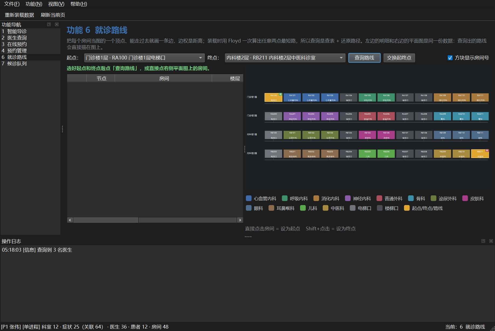

**操作步骤**：

1. **上方选起点与终点**：两个下拉框列出了全部 48 个房间（按楼层分组，
   格式为「门诊楼1层 · RA101 门诊楼1层电梯口」）
2. 点「**查询路线**」
3. 左侧显示路线明细表：

| 列 | 含义 |
|---|---|
| 起/终 | 标记起点与终点 |
| 节点 | 路网节点号 |
| 房间 | 房间名称 |
| 楼层 | 所在楼层 |
| 累计距离 | 从起点走了多少米 |

4. 表格下方是**换层指引**，例如「在「门诊楼1层电梯口」乘电梯，到达 4 层的「内科楼2层电梯口」」
5. **右侧平面图**会把你选的路线描成橙色

#### 更快的用法：直接点地图

右侧楼层平面图上，**每个房间是一个彩色方块**：

- **直接点击**方块 = 设为**起点**
- **按住 Shift 再点击** = 设为**终点**
- 点完点「查询路线」即可

方块里默认显示房间号，取消勾选右上角的「**方块显示房间号**」则改显示科室名。

#### 其它按钮

- 「**交换起终点**」：起点终点对调
- 图例（地图下方）：标明 12 个科室各自的颜色，以及电梯口 / 楼梯口 / 路线高亮

---

### 3.7 功能 7：候诊队列

到院后签到排队，看还要等多久。

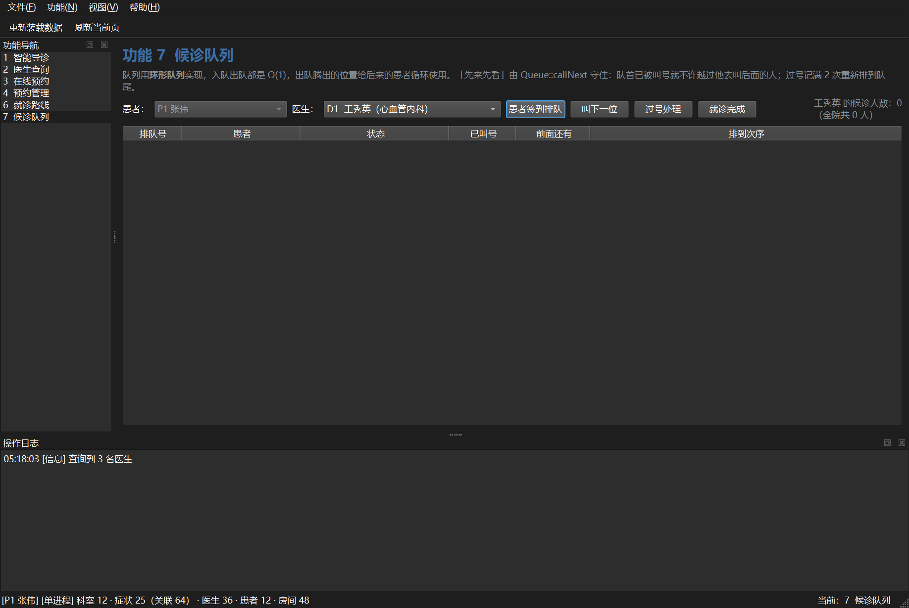

**操作步骤**：

1. **患者**：已锁定为登录者
2. **医生**：选你要看的医生（就是你预约的那位）
3. 点「**患者签到排队**」

签到成功后，表格里会出现你的记录：

| 列 | 含义 |
|---|---|
| 排队号 | 你的排队序号，如 1 |
| 患者 | 姓名 |
| 状态 | 等待中 / 已叫号，请进诊室 / 已过号 N 次 |
| 已叫号 | 被叫了几次 |
| 前面还有 | 你前面还有几个人 |
| 排到次序 | 第几位 |

**要点**：

- 签到后会提示「签到成功：P1 张伟 → D1 王秀英，排队号 1（前面 0 人）」
- 同一个医生不能重复签到，会提示「已经在队列里了，当前位置第 N 位」
- 队列满了会提示「候诊队列已满，请稍后再签到」
- **叫号、过号、就诊完成由管理端（医生）操作**，患者端只要看自己的状态变化即可

---

## 四、管理端使用说明

管理端**不需要登录**（它代表医院，不是某个具体的人）。

启动：

```bat
tools\run_qt.bat admin
```

左侧导航有 **7 个页面**：医生查询、预约管理、排班展示、就诊路线、候诊队列、人员管理、数据总览。

---

### 4.1 医生查询 / 4.4 就诊路线

这两页与患者端**完全一样**，用法见 3.3 和 3.6，只是管理端不做身份限制。

管理端「医生查询」：

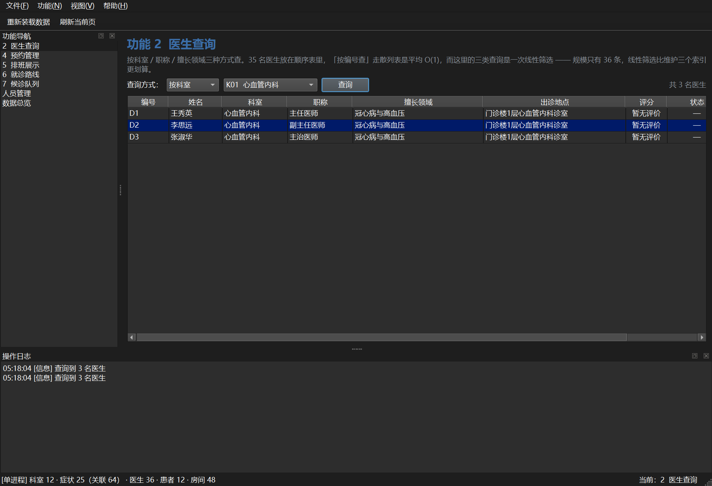

管理端「就诊路线」：

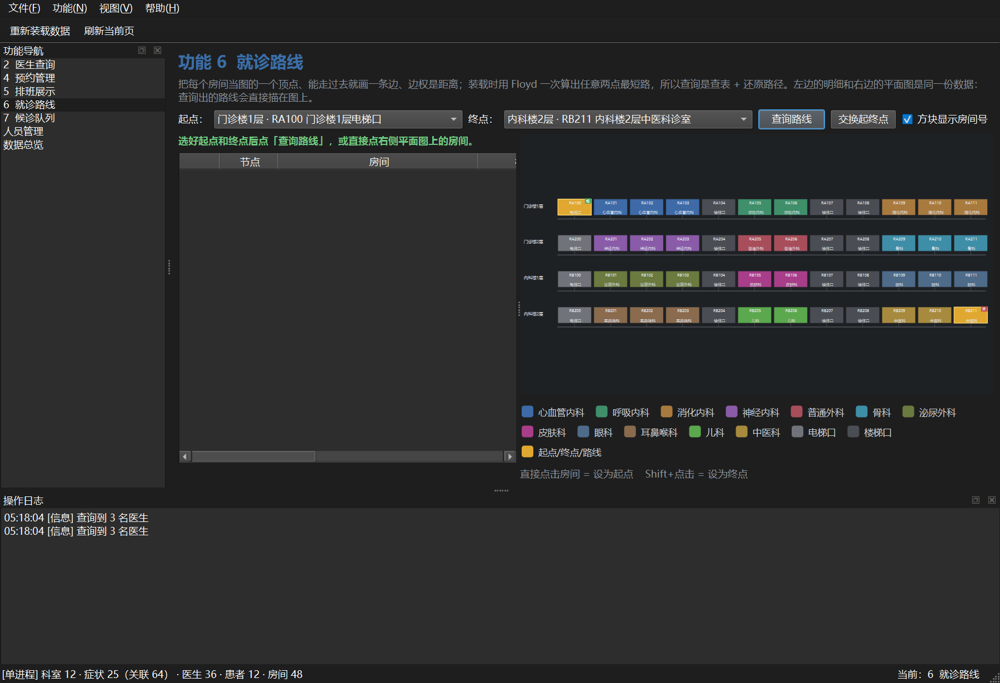

---

### 4.2 预约管理

和患者端同页，但管理端可以**查看任意患者**的预约记录。

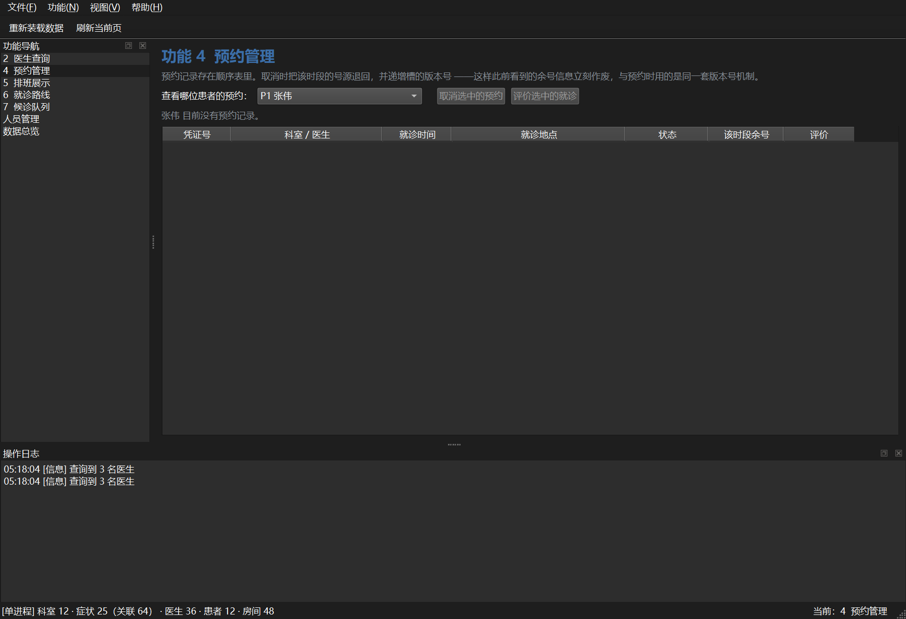

**操作**：

1. 在「查看哪位患者的预约」下拉框里选患者
2. 表格列出该患者的全部预约
3. 可以「取消选中的预约」（用于患者来电要求退号的情况）

> 管理端**不能代替患者评价** —— 评价由患者本人在患者端完成。

---

### 4.3 排班展示（含停诊与换班）

这是管理端最重要的页面。

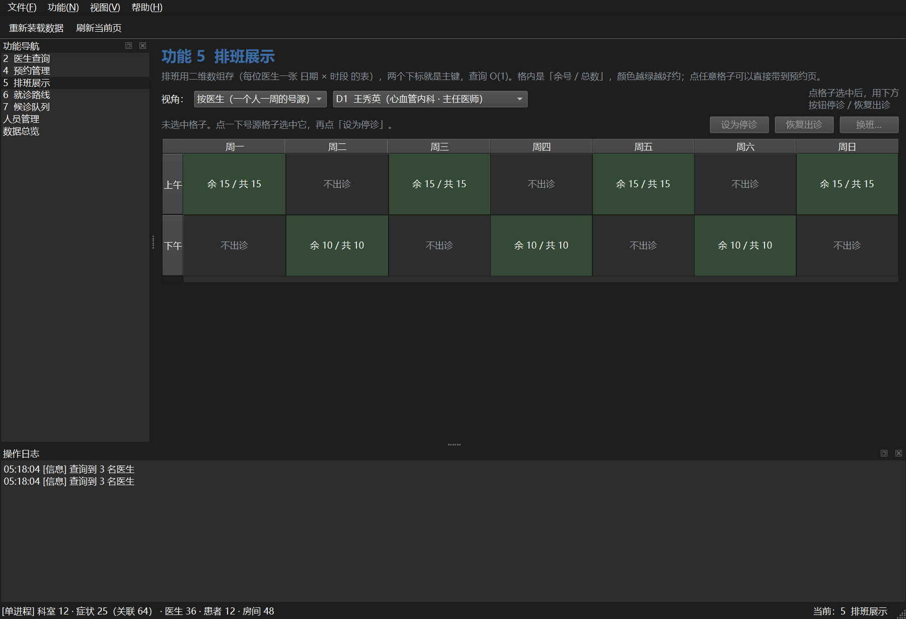

#### 两种视角

「**视角**」下拉框可切换：

- **按医生（一个人一周的号源）** —— 一位医生 7 天 × 2 时段的日历，格内是「余号/总数」
- **按科室汇总（全科医生对比）** —— 选科室后，列出该科全部医生 × 一周各时段

#### 停诊

1. 点一下号源格子**选中**它（下方会显示"已选中：D1 王秀英 · 周一上午"）
2. 点「**设为停诊**」
3. 弹窗会告诉你该时段有多少条已预约，确认后执行

**停诊时系统会自动做两件事**：

1. 该时段的预约标记为「因停诊取消」
2. **自动帮患者找替代时段改约** —— 按优先级：
   - 同一位医生、同一天、另一个时段
   - 同一位医生、其它天、同一时段
   - 同科室其它医生、同一天、同一时段

改约成功会生成新凭证，原记录标记为「因停诊改约」留痕。
结果会提示：「已停诊：… 。3 位患者已自动改约到其它时段」，
或者「…2 位自动改约成功，1 位没找到合适时段，需患者自行重约」。

#### 换班

停诊是"这个时段没号了"，换班是"号还是这些，只是换个医生看"。

1. 选中药源格子
2. 点「**换班…**」
3. 在弹出的对话框里选目标医生（先列出同科室的，再列其它科室在本时段出诊的）
4. 确认

**换班后**：该时段已有的预约会**一起转给新医生**，患者什么都不用改 ——
到院时间、诊室都不变，只是接诊医生换了。

#### 恢复出诊

停诊后可以点「**恢复出诊**」撤销停诊。

> 注意：恢复出诊**不会**自动恢复那些因停诊被取消的预约（号已经被别人约走了）。

---

### 4.5 候诊队列（叫号）

医生在这里操作叫号。

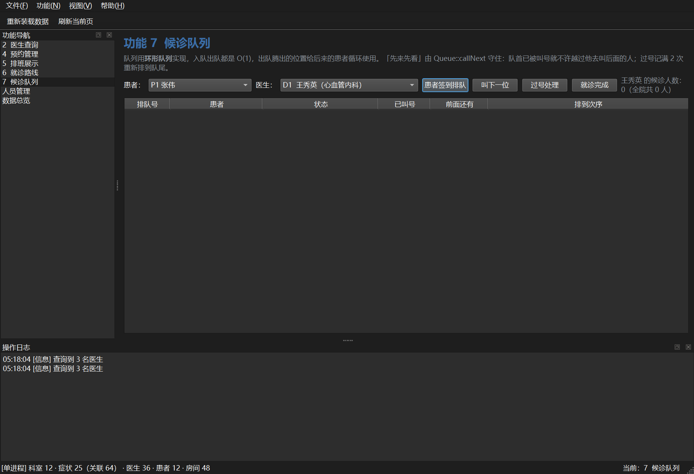

**四个按钮**：

| 按钮 | 作用 |
|---|---|
| **患者签到排队** | 代替患者在分诊台签到入队 |
| **叫下一位** | 叫该医生队伍里第一个还没被叫号的人 |
| **过号处理** | 叫了人没来，记一次；记满 2 次重新排到队尾 |
| **就诊完成** | 这位患者看完了，离开队列 |

**规则**：

- **先来先看**：队首的人一旦被叫号，就不能越过他去叫后面的人，
  会提示「队首的人已被叫号还未处理完，不能越过他叫下一位」
- 被叫到的人**仍然留在队列里**（状态变成「已叫号，请进诊室」），
  直到医生点「就诊完成」才真正离开
- **就诊完成时，系统会把对应的预约记录标记为「已完成」** ——
  这是患者能够评价医生的前提

---

### 4.6 人员管理（登记患者与医生）

新患者建档、新医生入职都在这里。

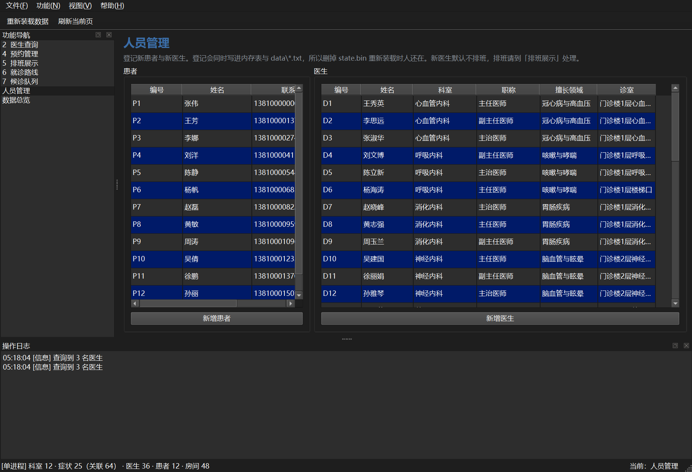

#### 新增患者

1. 点左侧「**新增患者**」
2. 填写：编号（系统会自动建议，如 `P13`）、姓名、联系电话（可留空）
3. 点确定

成功后左侧表格立刻多出一行，**数据同时写回 `data\patients.txt`**，
所以下次重新装载数据时这位患者仍然在。

#### 新增医生

1. 点右侧「**新增医生**」
2. 填写：编号（自动建议 `D37`）、姓名
3. 下拉选择：科室、职称、诊室（也可以选「暂不安排」）
4. 填写擅长领域
5. 点确定

**注意**：

- 编号**不能重复**，重复会提示「编号已存在」
- 职称只能是：主任医师 / 副主任医师 / 主治医师 / 住院医师
- **新医生默认没有排班** —— 排班来自 `data\schedules.txt`，
  新登记的医生需要另行为他安排出诊时段（改数据文件后重新装载）

---

### 4.7 数据总览（自检与审计）

这一页是给管理员做"体检"用的。

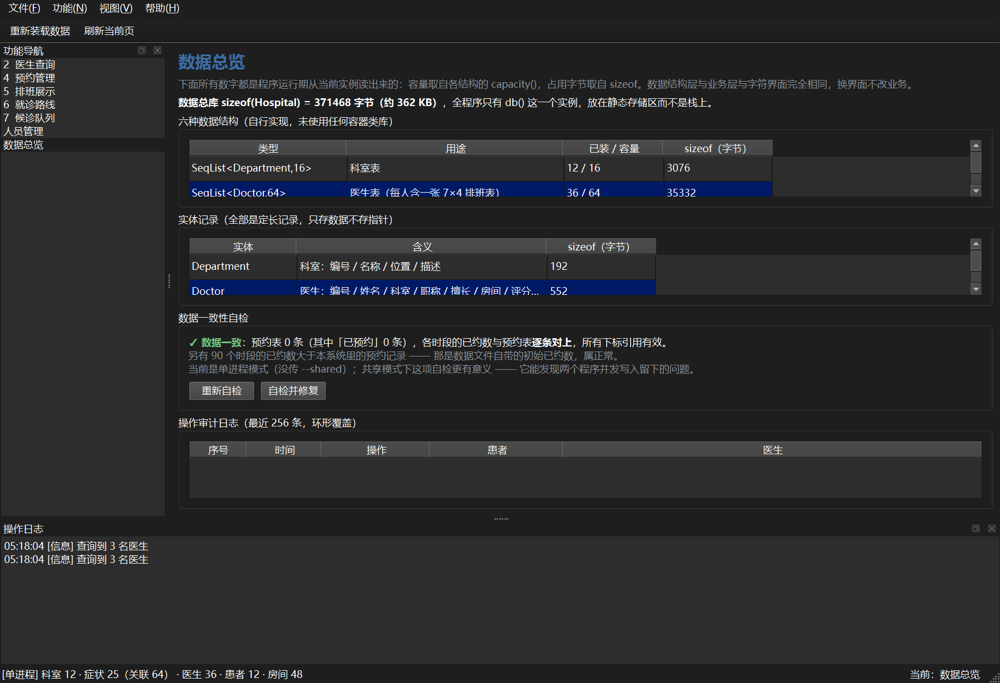

包含四块内容：

#### ① 六种数据结构占用情况

每个自研结构装了多少条、容量多少、`sizeof` 多少字节。全部是运行期实测值。

#### ② 实体记录大小

每种实体的字节数（如 `Doctor` 552 字节、`Hospital` 370444 字节）。

#### ③ 数据一致性自检

点「**重新自检**」会检查：

- 每个时段的「已约数」是否与预约表对得上
- 是否有指向不存在的医生/患者的脏数据
- 是否有负数余号
- 是否有表已用超过 90% 容量

正常时显示绿色的「**✓ 数据一致**」。
发现异常时显示红色的「✗ 发现不一致」，可以点「**自检并修复**」——
系统会以**预约表为准**重新计算各时段的已约数并写回。

> 说明：如果显示"另有 N 个时段的已约数大于本系统的预约记录"，这是**正常的** ——
> 那些是数据文件里自带的初始已约数（医院已有的预约，不在本系统里）。

#### ④ 操作审计日志

记录最近 256 条操作（预约、取消、签到、叫号、停诊、换班、评价、登记人员等），
最新的排在最上面。每条包含序号、时间、操作类型、患者、医生。

---

## 五、两端同时使用（共享模式）

这是本系统的一个特点：**两个程序可以同时运行并共享同一份数据**。

### 5.1 启动方式

打开两个命令行窗口，分别执行：

```bat
:: 窗口 1
tools\run_qt.bat patient --shared

:: 窗口 2
tools\run_qt.bat admin --shared
```

### 5.2 能看到什么效果

- **先启动的那个窗口**会打印「[共享] 首次初始化共享数据区」，负责把文本数据装进共享区
- **后启动的窗口**会打印「[共享] 复用已有的共享数据」
- 两边的**状态栏**会互相显示对方：

```
[P1 张伟] [共享 · 对端 1 个：管理端 · 写计数 3] 科室 12 · ...
```

### 5.3 可以演示的联动效果

| 在管理端做 | 在患者端点 |
|---|---|
| 停诊某个时段 | 「预约管理」里状态变成「因停诊改约」，并多出一条新时段的记录 |
| 换班 | 「预约管理」里医生名字变了，时间地点不变 |
| 叫号 | 「候诊队列」里状态变成「已叫号，请进诊室」 |
| 就诊完成 | 「预约管理」里状态变成「已完成」，评价按钮变可用 |
| 登记新患者 | 该患者可以立刻在患者端登录 |
| 在排班页改号源 | 患者端预约页的号源格子会自动刷新 |

界面每 700 毫秒检查一次对方有没有改数据，改了会自动刷新当前页并提示
「检测到另一端修改了数据，已刷新当前页」。

### 5.4 如果共享模式出问题

| 现象 | 处理 |
|---|---|
| 提示「共享数据区连接失败，退回单进程模式」 | 程序仍可正常使用，只是看不到对方改动。检查 `data\` 目录是否可写 |
| 数据看起来是旧的 | 关闭两个程序，删除 `data\state.bin`，重新启动（会从文本数据重新装载） |
| 状态栏显示「对端异常退出」 | 对方程序被强制关闭了，重新打开即可 |

> `data\state.bin` 是共享数据区文件，**不是数据源**。删掉它是安全的，
> 下次启动会从 `data\*.txt` 重新装载。

---

## 六、快捷键与通用操作

| 快捷键 | 作用 |
|---|---|
| `Ctrl+1` ~ `Ctrl+9` | 直接切到第 N 个功能页 |
| `F5` | 刷新当前页 |
| `Ctrl+R` | 重新装载数据（会丢弃当前所有改动） |

**菜单栏**：

- **文件** → 重新装载数据 / 退出
- **功能** → 各功能页（带 `Ctrl+N` 快捷键）
- **视图** → 显示/隐藏「功能导航」与「操作日志」（这两个面板可以拖动、浮动、关闭）
- **帮助** → 关于本程序

**界面通用元素**：

- **左侧「功能导航」**：点击切换页面，当前页会高亮
- **底部「操作日志」**：显示每次操作的结果，带时间戳，保留最近 500 行
- **状态栏**：左边是运行模式与数据规模，右边是当前页与最新提示

---

## 七、常见问题

**Q：患者端登录时提示"没有找到建档记录"？**

A：说明还没建档。让医院工作人员在管理端「人员管理」→「新增患者」里登记，
编号姓名填对即可。登记完回患者端直接用姓名登录，不用重启。

**Q：预约时提示"你在该时段已有预约"？**

A：同一个人同一时段只能有一张有效预约。先到「预约管理」取消原来那张。

**Q：成功预约了，但管理端看不到？**

A：两个程序默认各自独立。要在启动时都加 `--shared` 参数才能共享数据。

**Q：数据改乱了想恢复？**

A：关闭程序，删除 `data\state.bin`（共享模式的运行期状态），
如果连 `data\*.txt` 也改坏了，重新执行 `tools\build.bat gen` 生成测试数据。

**Q：评价按钮是灰的点不了？**

A：只有状态为「已完成」且还没评过价的预约才能评价。
「已完成」需要医生在管理端「候诊队列」里点「就诊完成」。

**Q：换班和停诊有什么区别？**

A：停诊 = 这个时段没号了，预约要改约或取消；换班 = 号源还在，
只是坐诊医生换了，已有的预约跟着一起转过去，患者什么都不用改。

**Q：新加的医生为什么在预约页看不到？**

A：新医生默认没有排班。排班数据来自 `data\schedules.txt`，
需要为他安排出诊时段（改数据文件后「重新装载数据」）。

---

## 附：功能与题目要求对照

| 题目要求 | 在哪个界面 |
|---|---|
| 智能导诊 | 患者端「1 智能导诊」 |
| 医生查询 | 两端「2 医生查询」 |
| 在线预约 | 患者端「3 在线预约」 |
| 预约管理 | 两端「4 预约管理」 |
| 排班展示 | 管理端「5 排班展示」 |
| 路线查询 | 两端「6 就诊路线」 |
| 候诊队列（实现提示 5 / 扩展 1） | 两端「7 候诊队列」 |
| 停诊或换班通知（扩展 2） | 管理端「5 排班展示」→ 设为停诊 / 换班 |
| 患者评价 + 推荐参考评分（扩展 3） | 患者端「4 预约管理」评价；「1/3」页推荐排序用到评分 |
| 科室间转诊推荐（扩展 4） | 患者端「3 在线预约」（号满时自动出现） |
| 人员登记（自行设计） | 管理端「人员管理」 |
| 数据自检与审计（自行设计） | 管理端「数据总览」 |
